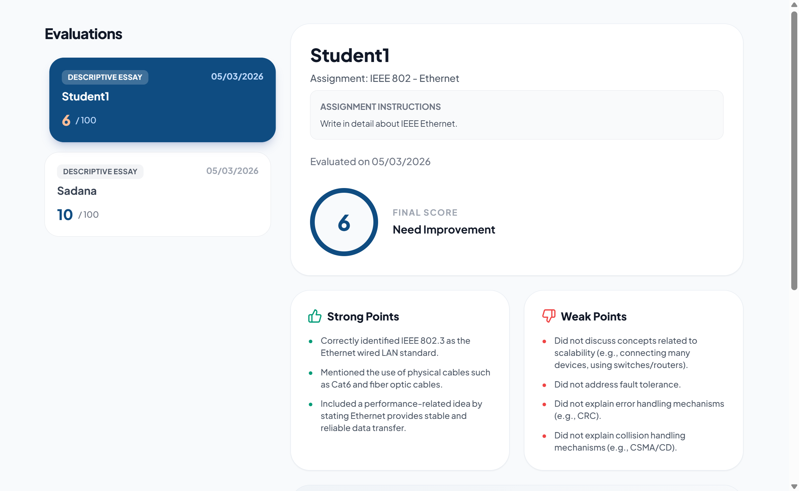
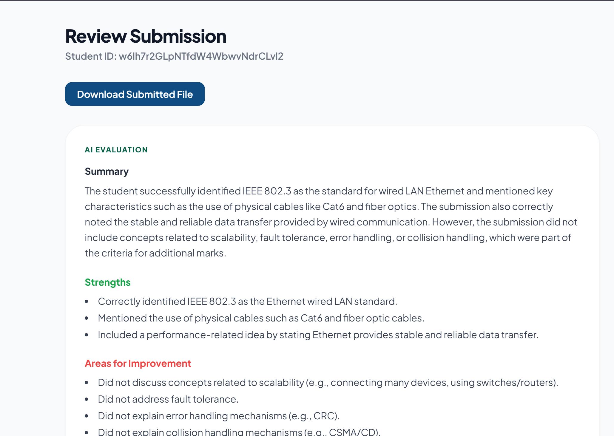

# Nexus Evaluator

Nexus Evaluator is an automated assignment evaluation system designed to streamline the grading workflow for teachers and provide faster feedback for students.

The platform allows students to upload handwritten or typed assignments, extracts the text using OCR, evaluates responses using AI, and returns structured feedback and scores.


## Tech Stack


* React
* TailwindCSS
* React Router
* Firebase
* Supabase
* FastAPI (Python)
* Gemini API 
* PyTesseract 

## System Architecture

The evaluation pipeline works as follows:

1. Student uploads an assignment through the frontend.
2. The file is stored in Supabase storage.
3. Backend retrieves the file.
4. PyTesseract performs OCR to extract the text from the document.
5. Extracted content is processed by the Gemini API.
6. Gemini evaluates the answers and generates structured grading feedback.
7. Results are stored in Firebase.
8. Students and teachers can view evaluations through the dashboard.

## Screenshots







## Installation

1. Clone the repository

```bash
git clone https://github.com/Govind-Sankar/nexus-evaluator.git
cd nexus-evaluator
```

### Backend Setup (FastAPI)

2. Create a virtual environment

```bash
cd backend
python -m venv venv
```

Activate the environment:

Mac / Linux

```bash
source venv/bin/activate
```

Windows

```bash
venv\Scripts\activate
```

3. Install dependencies

```bash
pip install -r requirements.txt
```

4. Configure environment variables

Create a `.env` file inside the backend directory:

```env
GEMINI_API_KEY=your_gemini_api_key

SUPABASE_URL=your_supabase_url
SUPABASE_SERVICE_KEY=your_supabase_service_key

GOOGLE_APPLICATION_CREDENTIALS=path_to_firebase_service_account.json
```

5. Run the backend server

```bash
uvicorn app.main:app --reload
```

### Frontend Setup

6. Install frontend dependencies

```bash
cd ../frontend
npm install
```

7. Configure frontend environment variables

Create a `.env` file inside frontend:

```env
REACT_APP_FIREBASE_API_KEY=your_key
REACT_APP_FIREBASE_AUTH_DOMAIN=your_domain
REACT_APP_FIREBASE_PROJECT_ID=your_project_id
REACT_APP_FIREBASE_STORAGE_BUCKET=your_bucket
REACT_APP_FIREBASE_MESSAGING_SENDER_ID=your_sender_id
REACT_APP_FIREBASE_APP_ID=your_app_id

REACT_APP_SUPABASE_URL=your_supabase_url
REACT_APP_SUPABASE_ANON_KEY=your_supabase_key
```

8. Start the frontend

```bash
npm start
```

### Running the Application

1. Start the FastAPI backend
2. Start the React frontend
3. Open the browser:

```
http://localhost:3000
```
